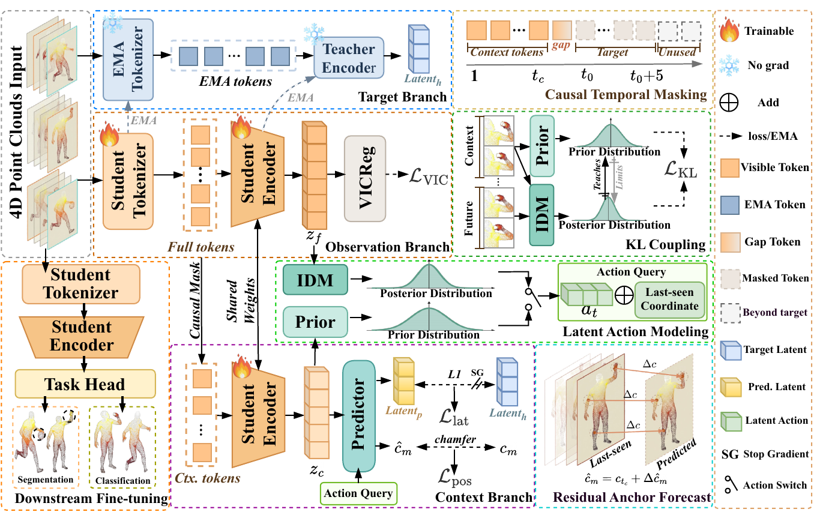

<h1 align="center">Latent World Modeling for Point-Cloud Video Pretraining</h1>

<p align="center"><i>PointWM (Point-cloud latent World Modeling) is a latent world model for self-supervised point-cloud video pretraining that forecasts the features and anchor geometry of future frames from strictly earlier context, without access to target positions.</i></p>

## Abstract

Masked modeling is the dominant self-supervised paradigm for point-cloud videos. However, it leaks the information it is meant to predict, whether it reconstructs masked points as in MAE-style methods or predicts their latent features. Because point-cloud tokens are anchored at points sampled from each frame, querying a target at its own position reveals where its geometry has moved, in reconstruction and latent prediction alike. For latent predictors, random spatio-temporal masks introduce a further shortcut, as visible frames on both sides of each target allow interpolation rather than forecasting. The pretext task thus reduces to completion. Once the target positions are withheld, a masked latent predictor performs only slightly better than copying the last frame. To remove this leakage, we propose PointWM, a latent world model that turns completion into forecasting by predicting the features and geometry of future frames from strictly earlier context. Each target is queried only with its last-seen position and timestamp, while a latent action learned without annotations is meant to capture the part of the future that the past leaves undetermined. On HOI4D action segmentation with a P4Transformer backbone, PointWM improves F1@50 over training from scratch by 24.9 offline and 29.1 under strictly causal inference. These results show the promise of latent world models as a leakage-free pretraining paradigm for point-cloud videos.

## Overview

<div align="center">
  
</div>

**Target branch.** EMA copies of the tokenizer and encoder encode the full clip into stop-gradient target latents. **Observation branch.** The student encodes the same full clip; the latent-action modules read these features, which are regularized by frame-level VICReg. **Context branch.** A causal temporal mask keeps only the frames before a one-frame gap. Queried with last-seen anchor coordinates, target timestamps and a latent action, the predictor outputs target latents (L1 loss) and residual anchor displacements (Chamfer loss). **Latent action.** An inverse dynamics model infers a posterior from frame-to-frame changes of the student features; a prior sees only the last context frame and the horizon. During training the posterior sample is replaced by the prior mean for 30% of clips; at prediction time the prior is always used. Only the student tokenizer and encoder are fine-tuned downstream.

## Getting Started

The following steps describe how to set up this repository and run pretraining, fine-tuning and the forecasting probe.

### Requirements

- Python 3.9+
- PyTorch 2.0+ with CUDA matching your driver
- Optional: the PointNet++ CUDA ops exposing `pointnet2.pointnet2_utils` (as used by P4Transformer). Without them, `pointwm/ops/torch_fallback.py` provides a pure-PyTorch FPS / ball query with the same semantics, which is correct but slow.

### Quick Start

```bash
conda create -n pointwm python=3.10 -y
conda activate pointwm

# Install PyTorch for your CUDA version (adjust the wheel index as needed)
pip install torch

pip install -r requirements.txt

# Sanity check on synthetic data (CPU, a few minutes): runs every config and entry point
python tools/smoke_test.py
```

### Datasets

**HOI4D** (action segmentation benchmark): the HDF5 shards `train1.h5` … `train4.h5` and `test1.h5`, `test2.h5` in one directory. Each shard holds `pcd` of shape `[N, 150, 2048, 3]` and per-frame labels `label` of shape `[N, 150]` (19 actions); 2,971 training and 892 test videos in total. The training videos are shuffled once with seed 17; the first 10% are held out for model selection and the rest are used for pretraining (without labels) and fine-tuning. No test video is seen in pretraining.

**MSR-Action3D**: one `a##_s##_e##_sdepth.npz` per video with key `point_clouds` (a list of `[n_i, 3]` frames). Naming: `a##` action, `s##` subject, `e##` execution. Subjects 1–5 are used for training (270 videos) and 6–10 for testing (297 videos).

Set `data.root` in `configs/pretrain/pointwm.yaml` and `configs/finetune/*.yaml` (or pass `--set data.root=...`).

<details>
<summary>click to expand — repository layout</summary>

```text
pointwm_code/
├── configs/
│   ├── pretrain/
│   │   ├── pointwm.yaml           # full PointWM (Table S1); all others inherit via _base_
│   │   ├── block.yaml  leak.yaml  last.yaml  teacher_act.yaml
│   │   └── ablation/              # Table 5 rows (c)–(l), Table 6, context-only normalization
│   └── finetune/
│       ├── hoi4d_offline.yaml  hoi4d_online.yaml  msr.yaml
├── fig/
├── pointwm/
│   ├── data/                      # HOI4D h5 / MSR loaders, normalization, augmentation
│   ├── masks/                     # causal mask, block mask, last-seen lookup
│   ├── models/                    # tokenizer, encoder, predictor, latent action, PointWM, downstream heads
│   ├── modules/                   # P4DConv, transformer, positional embedding
│   ├── ops/                       # FPS / ball query (CUDA ext or torch fallback)
│   └── utils/
├── scripts/                       # pretrain_all.sh, finetune_all.sh, probe_all.sh, ...
├── tools/                         # probe_forecast.py, aggregate_probe.py, summarize_seeds.py, ...
├── train_pretrain.py
├── finetune_hoi4d_seg.py
└── finetune_msr.py

/path/to/HOI4D_AS_h5/              # pass as data.root for HOI4D
├── train1.h5 … train4.h5
└── test1.h5  test2.h5

/path/to/MSRAction3D/npz/          # pass as data.root for MSR-Action3D
└── a##_s##_e##_sdepth.npz
```

</details>

Shell helpers in `scripts/` run every configuration with seeds 0, 1, 2 on 4 GPUs.

## Main Results

All rows use a P4Transformer backbone. *Scratch* is the same backbone without pretraining; *Block*, *Leak* and *Last* differ from PointWM only in the pretext objective. PointWM reports the mean ± std over three seeds.

**HOI4D action segmentation (offline, 150-frame inputs) and MSR-Action3D accuracy (%)**

| Pretraining | Acc | Edit | F1@10 | F1@25 | F1@50 | MSR |
|---|---|---|---|---|---|---|
| Scratch | 71.2 | 73.1 | 73.8 | 69.2 | 58.2 | 90.94 |
| Block | 76.4 | 78.7 | 81.3 | 78.0 | 69.8 | 91.92 |
| Leak | 78.0 | 80.8 | 83.6 | 80.7 | 73.6 | 92.37 |
| Last | 80.3 | 84.9 | 87.7 | 85.2 | 78.4 | 93.94 |
| **PointWM** | **82.5** ± 0.4 | **87.2** ± 0.5 | **90.4** ± 0.4 | **88.7** ± 0.4 | **83.1** ± 0.6 | **95.06** ± 0.39 |

**Strictly causal online action segmentation on HOI4D (no look-ahead)**

| Pretraining | Acc | Edit | F1@10 | F1@25 | F1@50 |
|---|---|---|---|---|---|
| Scratch | 66.7 | 62.0 | 65.3 | 59.8 | 46.3 |
| Leak | 70.2 ± 0.7 | 64.8 ± 1.1 | 73.5 ± 0.8 | 67.3 ± 1.3 | 56.1 ± 0.9 |
| Last | 76.8 ± 0.9 | 76.9 ± 1.2 | 81.9 ± 1.1 | 77.7 ± 0.9 | 68.6 ± 0.8 |
| **PointWM** | **81.0** ± 0.4 | **83.0** ± 0.6 | **85.9** ± 0.7 | **84.4** ± 1.1 | **75.4** ± 0.8 |

**Latent forecasting by frozen pretrained models on HOI4D** (averaged over t+1 to t+6; skill against copy-last CL, context mean CM and linear extrapolation LE; CL\* queries with the true target anchors as a leakage diagnostic)

| Pretraining | CL\* | CL | CM | LE | ΔR² | ΔR² (moving) | cos |
|---|---|---|---|---|---|---|---|
| Block | 0.81 | 0.03 | −0.35 | −0.12 | 0.05 | 0.04 | 0.26 |
| Leak | 0.85 | −0.07 | −0.18 | −0.12 | −0.08 | −0.12 | 0.09 |
| Last | – | 0.42 | 0.29 | 0.25 | 0.47 | 0.39 | 0.75 |
| **PointWM** | 0.54 | **0.52** | **0.40** | **0.37** | **0.58** | **0.49** | **0.81** |

## Training and finetuning

**Appendix (paper):** pretraining uses 32-frame clips at frame interval 2, **2048** points and **64** FPS anchors per frame, ball-query radius 0.05 with 32 neighbours, temporal kernel 3 / stride 1, student encoder 384 / 6 / 6, predictor 256 / 4 / 4, K = 6 target anchors after a one-frame gap with at least 12 context anchors, d_a = 8, λ_pos = 5, β_q = 0.05, λ_fb = 0.2, β_p = 0.5, λ_VIC = 0.1, EMA 0.996 → 1.0, AdamW for **100** epochs (15 warmup) with peak lr 5e-4 decaying to 1e-6, weight decay 0.05 and **batch 64** on **4× A800**. Fine-tuning runs end to end for 30 epochs. Batch sizes are global; the scripts divide them by the number of GPUs.

### Self-supervised pretraining

`train_pretrain.py` trains PointWM and every controlled variant; the variant is chosen by the config. Checkpoints are written to `{out_dir}/seed{seed}/` (`epoch099.pt` is the one used downstream; `last.pt` is for resuming).

```bash
# Paper: batch 64 on 4× A800, seeds 0 / 1 / 2.
torchrun --nproc_per_node 4 train_pretrain.py \
  --config configs/pretrain/pointwm.yaml \
  --seed 0 \
  --set data.root=/path/to/HOI4D_AS_h5
```

Controlled variants and ablations use the same command with another config:

| Paper | Config |
|---|---|
| Block / Leak / Last | `configs/pretrain/block.yaml` / `leak.yaml` / `last.yaml` |
| Teacher act. | `configs/pretrain/teacher_act.yaml` |
| Table 5 (c) (d) (e) | `ablation/c_no_block.yaml`, `d_frame_vicreg.yaml`, `e_pos_head.yaml` |
| Table 5 (g) (h) | `ablation/g_gap0.yaml`, `h_token_vicreg.yaml` |
| Table 5 (i) (j) (k) (l) | `ablation/i_target_query.yaml`, `j_noised_small.yaml`, `k_noised_large.yaml`, `l_time_only.yaml` |
| Table 6 | `ablation/la_fixed_prior.yaml`, `la_idm_state.yaml` |
| Context-only normalization | `ablation/norm_context.yaml` |
| Hyperparameter sensitivity | `bash scripts/pretrain_sensitivity.sh` (one `--set` change at a time) |

Any config value can be overridden with `--set key.sub=value` (e.g. `--set model.causal.num_targets=4`). Resume with `--resume auto`. `bash scripts/pretrain_all.sh` runs all configs with three seeds.

### Action recognition (classification)

**MSR-Action3D**: 24-frame clips at interval 1 cut by a sliding window with stride 1, **2048** points per frame, lr 5e-4, global batch 32. A video is classified by summing the softmax over its clips, and the model is evaluated once at the last epoch on all 297 test videos.

```bash
torchrun --nproc_per_node 4 finetune_msr.py \
  --config configs/finetune/msr.yaml \
  --init_ckpt /path/to/pretrain/seed0/epoch099.pt \
  --seed 0 \
  --set data.root=/path/to/MSRAction3D/npz
```

Use `--init_ckpt none` for the Scratch baseline.

### HOI4D temporal action segmentation

**Offline**: 150-frame sequences in normalized coordinates, **2048** points per frame, lr 1e-4, global batch 8, temporal mode filter of width 9, model selection on validation F1@50 and a single test evaluation.

```bash
torchrun --nproc_per_node 4 finetune_hoi4d_seg.py \
  --config configs/finetune/hoi4d_offline.yaml \
  --init_ckpt /path/to/pretrain/seed0/epoch099.pt \
  --seed 0 \
  --set data.root=/path/to/HOI4D_AS_h5
```

Add `data.label_frac=0.1` to `--set` for Seg<sub>10%</sub>; `bash scripts/label_efficiency.sh` sweeps 1–100% of the labels.

**Online (strictly causal)**: raw HOI4D coordinates, a causal P4DConv temporal kernel over frames t−2 to t (the pretrained offsets −1, 0, +1 are transferred to −2, −1, 0 without changing any weight), a causal attention mask, and no smoothing.

```bash
torchrun --nproc_per_node 4 finetune_hoi4d_seg.py \
  --config configs/finetune/hoi4d_online.yaml \
  --init_ckpt /path/to/pretrain/seed0/epoch099.pt \
  --seed 0 \
  --set data.root=/path/to/HOI4D_AS_h5
```

`bash scripts/finetune_all.sh runs/pretrain/pointwm` runs offline, Seg<sub>10%</sub>, online and MSR-Action3D for seeds 0–2 (`bash scripts/finetune_all.sh none scratch` for Scratch). `python tools/summarize_seeds.py runs/seg_online/pointwm/seed*/results.json` prints the mean ± std.

### Forecasting probe

Each frozen model is probed on 200 unaugmented 32-frame HOI4D test clips: the first 25 anchor frames are context and the six frames after a one-frame gap are forecast, queried with last-seen anchors and conditioned on the prior-mean action. The probe reports skill (CL / CM / LE / CL\*), ΔR² (all and moving tokens), the direction cosine, autoregressive rollout, anchor Chamfer distance, effective rank, Δ<sub>act</sub> and clip variance.

```bash
python tools/probe_forecast.py \
  --ckpt /path/to/pretrain/seed0/epoch099.pt \
  --root /path/to/HOI4D_AS_h5 \
  --out probe/pointwm_s0
```

`tools/aggregate_probe.py` averages the seeds and computes the 95% bootstrap confidence intervals of the per-horizon curves (`metric,series,horizon,mean,ci_low,ci_high`); `HOI4D=/path/to/HOI4D_AS_h5 bash scripts/probe_all.sh` probes every pretrained run and writes the curves.

## License

This project is released under the [MIT License](LICENSE).
